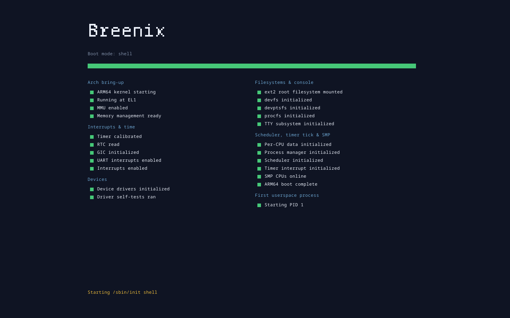
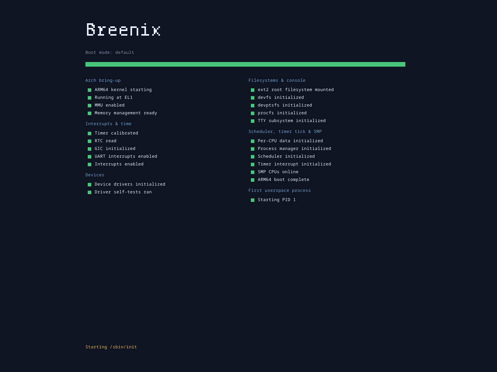
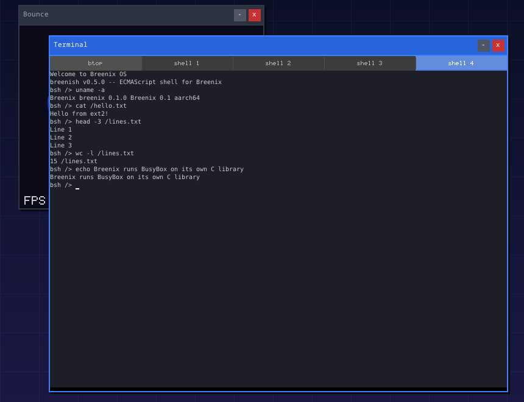
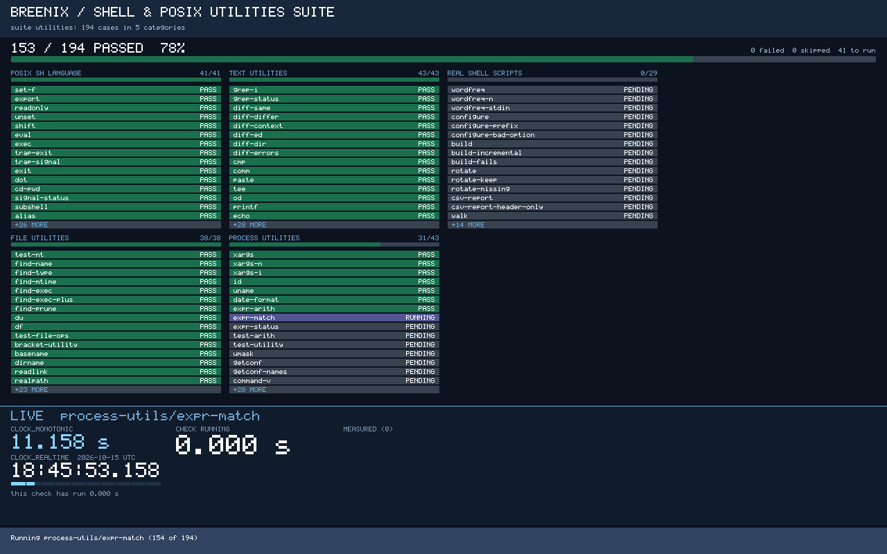
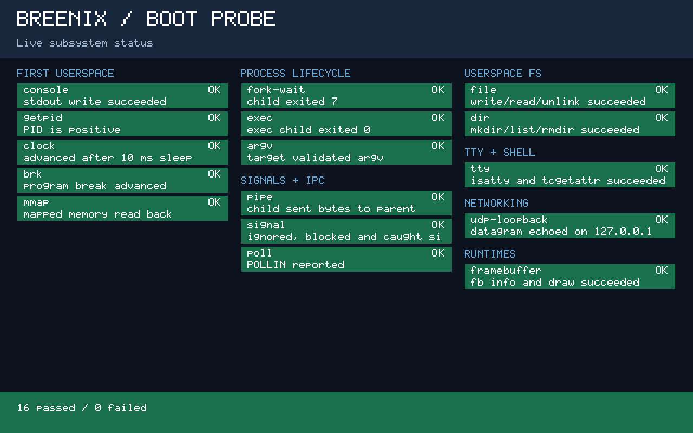

# Breenix

As of 2026-10-18 (S23), x86-64 requires evidence from x86-metal using the metal boot loop.
The main path measures ARM64 QEMU, Parallels and VMware. Earlier x86 QEMU gate
and landing requirements below are superseded by [the execution policy](docs/x86-execution-policy.md);
legacy QEMU commands require the operator's `BREENIX_ALLOW_X86_QEMU=1`.

Breenix is a POSIX operating system kernel written from scratch in Rust for ARM64 and x86-64.
On top of the kernel sit its own clean-room C library, a port of the Rust standard library, a
shell with POSIX utilities (BusyBox built against Breenix's C library), and a Developer SDK for
building C and Rust programs outside this tree. It boots on QEMU, Parallels Desktop and VMware
Fusion on ARM64, and through the x86-metal boot loop on x86-64.

POSIX suites gate the main path on ARM64 QEMU, Parallels and VMware. x86-64 evidence
belongs to the independent metal path.

| | |
|---|---|
|  |  |
| The boot path on ARM64 QEMU | The boot path on Parallels Desktop |
|  |  |
| The shell running utilities in the desktop's terminal, on Parallels | The Shell & POSIX utilities suite running on ARM64 QEMU |

## Where it stands

Breenix is built along an ordered effort path ([`docs/efforts/path.json`](docs/efforts/path.json)).
Each effort has an outcome and milestones, and each milestone is measured by a boot or a suite,
never by a rating someone sets. The table shows the effort path on `main` at `793810cb`
(2026-10-15). The counts are the suite cases passing on every one of the four targets.

| # | Effort | Suite | Passing on three main-path targets | Status |
|---|---|---|---|---|
| 0 | Kernel bring-up | [boot path](docs/boot-path.md) | 6 boot-path milestones; x86 hardware profiles retained, unmeasured on this path | done |
| 1 | Files & I/O | [`files-io`](docs/suites/files-io.json) | 219 of 219 | done |
| 2 | Directories & links | [`directories`](docs/suites/directories.json) | 117 of 117 | done |
| 3 | Processes | [`processes`](docs/suites/processes.json) | 153 of 153 | done |
| 4 | Signals | [`signals`](docs/suites/signals.json) | 125 of 125 | done |
| 5 | Time & timers | [`time`](docs/suites/time.json) | 92 of 92 | done |
| 6 | Memory | [`memory`](docs/suites/memory.json) | 120 of 120 | done |
| 7 | Threads | [`threads`](docs/suites/threads.json) | 142 of 142 | done |
| 8 | IPC | [`ipc`](docs/suites/ipc.json) | 140 of 140 | done |
| 9 | Terminals & job control | [`terminals`](docs/suites/terminals.json) | 151 of 151 | done |
| 10 | Networking & sockets | [`networking`](docs/suites/networking.json) | 194 of 194 | done |
| 11 | C library | [`libc`](docs/suites/libc.json) | 258 of 258 | done |
| 12 | Rust std | [`rust-std`](docs/suites/rust-std.json) | 173 of 174 | ahead: one `std::net` read-timeout case on x86-64 |
| 13 | Shell & POSIX utilities | [`utilities`](docs/suites/utilities.json) | 194 of 194 | done |
| 14 | Developer SDK | [`sdk`](docs/suites/sdk.json) | 108 of 108 | done |
| 15 | BreenGL graphics library | `breengel` | suite not written yet | next |
| 16 | Window manager | `window-manager` | suite not written yet | next |
| 17 | UI test framework | `ui-testing` | suite not written yet | next |
| 18 | GUI applications | `gui-apps` | suite not written yet | next |

That is 2,186 of 2,187 suite cases on every target and 14 of 19 efforts done. The four GUI
efforts come next: a graphics library, the window manager, a UI test framework and the desktop
applications, each held to the same four-target bar. Their plan is [`docs/gui/plan.md`](docs/gui/plan.md),
with a short version in [`docs/gui/summary.md`](docs/gui/summary.md).

## Build and boot

Breenix is developed on Apple Silicon Macs, where ARM64 boots natively under QEMU with HVF,
Parallels Desktop and VMware Fusion. x86-64 boots through x86-metal using the metal boot loop.

You need:

- `rustup`. [`rust-toolchain.toml`](rust-toolchain.toml) pins the nightly toolchain and its components.
- LLVM: clang 18 or newer with `llvm-nm`, `llvm-ar` and `llvm-objcopy` beside it. The C library,
  BusyBox and C userspace programs build with it. On macOS install Homebrew's `llvm`
  (`brew install llvm`); the build finds it without a `PATH` change, and Apple's
  `/usr/bin/clang` does not ship those tools.
- QEMU (`qemu-system-aarch64`) for ARM64 boots.
- Docker, which builds the ext2 disk image on macOS.
- Python 3.11 or newer (`scripts/rust-fork.sh` uses `tomllib`; macOS's system Python 3.9 is too old).
- The forked Rust standard library, described below.

### The forked Rust standard library

Userspace programs are built against a fork of the Rust standard library that
knows `target_os = "breenix"`. [`rust-fork.toml`](rust-fork.toml) pins the fork's
repository and commit. Given a clone of that repository, `scripts/rust-fork.sh sync` checks
the pinned commit out as an untracked `rust-fork` worktree inside this checkout:

```bash
git clone https://github.com/ryanbreen/rust.git ../rust
BREENIX_RUST_FORK_SOURCE=../rust scripts/rust-fork.sh sync
```

Builds that compile userspace can also be pointed at a fork somewhere else:

```bash
export BREENIX_RUST_FORK_LIBRARY=/path/to/rust-fork/library
```

Both builders honour it — `userspace/programs/build.sh` and `xtask`. Without it
they fall back to `<repo>/rust-fork/library`, so a local (untracked) `rust-fork`
directory inside the checkout is the simplest layout.

The fallback layout is not merely a convenience. The fork's
`library/Cargo.toml` patches `libc` to `../../libs/libc`, which resolves
relative to the fork's own parent directory — so the fork has to sit beside a
`libs/libc`, as it does when it lives inside this checkout. Pointing
`BREENIX_RUST_FORK_LIBRARY` at a fork laid out anywhere else gets past the
"forked Rust library not found" check and then fails on that patch instead.

`rust-fork` is deliberately git-ignored rather than committed: it was once
tracked as a symlink to one developer's absolute home path, which dangled in
every other checkout and failed the userspace build with no usable diagnostic
(#678, #679).

### Boot ARM64 on QEMU

[`scripts/boot-interactive.sh`](scripts/boot-interactive.sh) builds userspace, the ext2 disk and
the kernel, then boots once with the serial console on your terminal (Ctrl-A X quits):

```bash
scripts/boot-interactive.sh                          # testing kernel: the boot-path gate
scripts/boot-interactive.sh --mode shell             # bsh on the serial console
scripts/boot-interactive.sh --mode probe             # one check per subsystem, ends with PROBE DONE
scripts/boot-interactive.sh --mode suite --suite files-io   # an effort suite as PID 1
```

`./run.sh` boots in a QEMU window; `./run.sh --headless` keeps it to the serial console.

The desktop (the window manager and its windows) composes through the GPU core,
syscall 416, on ARM64 QEMU with `--gpu-gl`, Parallels and VMware: bwm uploads its
decorations and each client's frames as textures, draws them into a scanout target and
presents it. bwm reads its first frame, and its first frame that shows a client's
pixels, back from the device and compares them with the frame it composed; the desktop
boot's boot-path stages require both. ARM64 QEMU launches without `--gpu-gl` have no
GPU-core device, so bwm reports `GPU compositing required` and exits there.



The builds it runs, if you want them on their own:

```bash
userspace/programs/build.sh --arch aarch64
scripts/create_ext2_disk.sh --arch aarch64
cargo build --release --target aarch64-breenix-kernel.json \
    -Z build-std=core,alloc -Z build-std-features=compiler-builtins-mem \
    -p kernel --bin kernel-aarch64          # add --features testing for the testing kernel
```

### Boot on Parallels Desktop and VMware Fusion

Both boot through a UEFI loader, which needs one more Rust target:

```bash
rustup target add aarch64-unknown-uefi
```

```bash
./run.sh --parallels                     # build, create a fresh VM and boot to the desktop
./run.sh --parallels --suite files-io    # run a suite, stop the VM at its DONE line
./run.sh --vmware --probe                # the boot probe on VMware
./run.sh --vmware --suite directories
```

### Boot x86-64

Use `scripts/metal/metal-run` and the [metal boot loop guide](docs/metal/README.md)
for x86-metal. x86 QEMU launchers refuse by default under S23; an exceptional
invocation requires the operator's `BREENIX_ALLOW_X86_QEMU=1`.

### Host tests

```bash
scripts/run-structure-tests.sh           # every tests/*_structure.rs suite
```

Breenix runs no builds or tests in hosted CI. Every check runs locally, and a pull request
lands with its own evidence.
[`docs/boot-path.md`](docs/boot-path.md) describes the boot path, its modes and the gates.

## Developer SDK

The SDK packages C and Rust toolchains for both architectures, so a program can be written,
built and installed onto a Breenix disk without this source tree.
[Build the SDK](docs/sdk/reference.md#host-prerequisites-and-sdk-build) into a directory of
your choice; that section also lists its host prerequisites. Installing onto a disk image
needs e2fsprogs' `debugfs` on the host (`brew install e2fsprogs` on macOS; Docker does not
stand in for it). Then create, build and install a program:

```bash
export BREENIX_SDK="$HOME/breenix-sdk" BREENIX_ARCH=aarch64
export BREENIX_IMAGE=/absolute/path/to/a/copy/of/ext2-aarch64.img
export PATH="$BREENIX_SDK/bin:$PATH"
breenix-new c hello-breenix            # or rust, or rust-no-std
cd hello-breenix
breenix-build --arch "$BREENIX_ARCH"
breenix-image install --image "$BREENIX_IMAGE" "build/$BREENIX_ARCH/hello-breenix"
```

[Boot that disk](docs/sdk/reference.md#run-an-installed-program) and run `hello-breenix` at the
shell. The SDK's documentation is in
[`docs/sdk/`](docs/sdk/): the [quick start](docs/sdk/quick-start.md), the
[reference](docs/sdk/reference.md) and [disk images](docs/sdk/disk-image.md).

## Repository layout

| Path | What it holds |
|---|---|
| [`kernel/`](kernel/) | The kernel: ARM64 and x86-64 architecture code, memory, scheduler, filesystems, drivers, networking |
| [`libs/`](libs/) | libbreenix, the clean-room C library (`libbreenix-libc`), graphics, font and GUI libraries |
| [`userspace/`](userspace/) | init, the shell, utilities, GUI programs and the guest side of every suite |
| [`sdk/`](sdk/) | The Developer SDK builder, compiler wrappers, project templates and tests |
| [`parallels-loader/`](parallels-loader/) | The ARM64 UEFI loader used on Parallels and VMware |
| [`xtask/`](xtask/), [`src/`](src/) | Build orchestration, the boot-stage catalog and the host-side QEMU launchers |
| [`scripts/`](scripts/), [`docker/qemu/`](docker/qemu/) | Build, disk-image, boot and gate scripts |
| [`tools/`](tools/) | Run Inspector, gdb-chat, the MCP server, host-test crates and Linux comparison probes |
| [`tests/`](tests/) | Host tests, structural checks and fixtures |
| [`vendor/`](vendor/), [`fonts/`](fonts/) | Pinned BusyBox and Unicode sources; fonts installed into guest images |
| [`docs/`](docs/) | The boot path, effort path, suites, GUI plan, SDK and user guide |

## Documentation

- [`docs/boot-path.md`](docs/boot-path.md): how Breenix boots, milestone by milestone, the boot modes and the gates.
- [`docs/efforts/`](docs/efforts/): the effort path and how each milestone is measured.
- [`docs/suites/`](docs/suites/): the suite manifests and how a suite run is scored.
- [`docs/gui/`](docs/gui/): the plan for graphics, the window manager, UI testing and GUI applications.
- [`docs/sdk/`](docs/sdk/): the Developer SDK.
- [`docs/user-guide/bsh-shell-guide.md`](docs/user-guide/bsh-shell-guide.md): the bsh shell.
- [`docs/planning/`](docs/planning/): historical investigations and design records.

## Contributing

Work is tracked in GitHub Issues. [`AGENTS.md`](AGENTS.md) and [`CLAUDE.md`](CLAUDE.md) hold the
development rules, including the constraints on interrupt and syscall paths and the
zero-warnings build policy. Agent skills live in [`.agents/skills/`](.agents/skills/).

## License

The root license for Breenix material offered by its author is
[PolyForm Noncommercial 1.0.0](LICENSE), permitting personal, research,
educational, hobby and other noncommercial use. Commercial use of material
under that license needs a separate license from the author.

Using Breenix? I'd love to hear about it: ryan@ryanbreen.com

Third-party material retains its own licenses; see [THIRD_PARTY_NOTICES](THIRD_PARTY_NOTICES).
